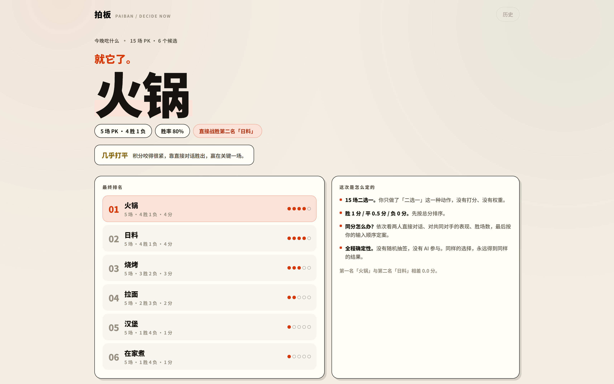
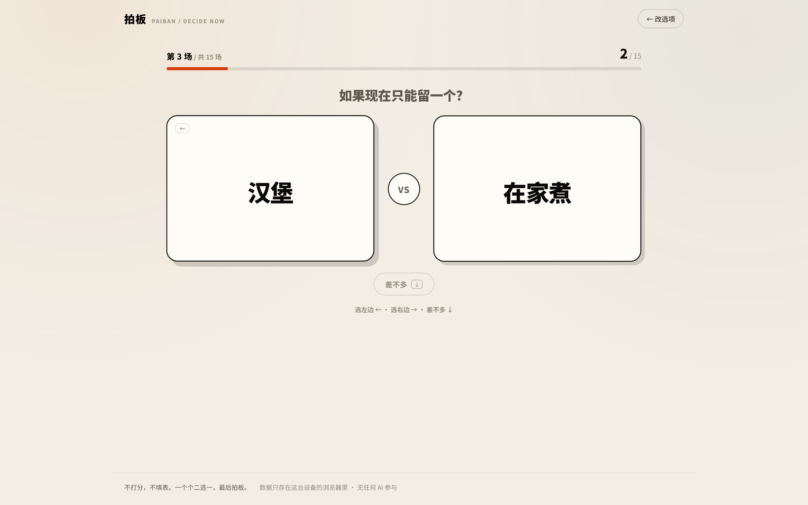
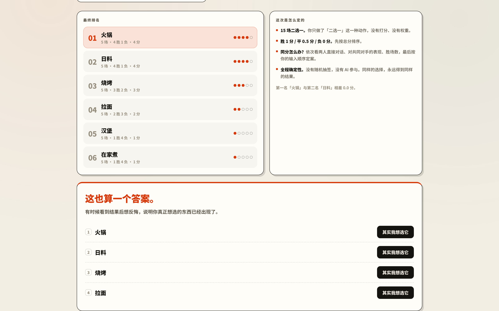

# 拍板 · PAIBAN

> 不打分，不填表。一个个二选一，最后拍板。

一个帮助你在几个候选之间快速做决定的工具：今晚吃什么、周末去哪、买哪个、先做哪件事。
普通抽签太随意，打分表太麻烦，「拍板」让你只做一种动作——**二选一**。

线上体验：<https://paiban-decide-now.app.workbuddy.host/>



## 怎么用

1. 把纠结的候选丢进来（2～8 个，Enter 快速新增）
2. 一场场 PK：如果现在只能留一个？[ 火锅 ] VS [ 日料 ]
3. 全部打完，直接看到「就它了。」——以及它是怎么赢的
4. 看到结果后想反悔？**反悔也是答案**，改选你真正想要的那个即可

支持键盘操作：`←` 选左边、`→` 选右边、`↓` 差不多。



## 为什么它比抽签有依据

- **计分透明**：胜 1 分 / 平 0.5 分 / 负 0 分，先按总分排序
- **同分不靠运气**：依次比较两人直接对话 → 对共同对手的表现 → 胜场数 → 原始输入顺序（稳定，禁止随机）
- **赛制合理**：2～6 个候选做完整两两对决；7～8 个候选先快速赛一轮（每人至少 2 场），积分前三再循环赛，不必打满 28 场
- **全程确定性**：没有随机数、没有 AI。同样的选择，永远得到同样的结果

## 反悔也是答案

结果出来后会问你一句：**看到这个结果，你第一反应是什么？**

如果答案是「等等，我好像更想选别的」，它不会把你当成错误处理——想反悔，恰恰说明你真正想要的东西已经出现了。改选即可定案。



## 本地运行

```bash
npm install
npm run dev      # 开发
npm run build    # 构建产物在 dist/
```

纯前端项目，无后端、无登录、无数据库。数据（历史记录）只存在浏览器 localStorage 里。

## 测试

```bash
# 算法自测（场次数、可复现性、同分 tie-break、循环克制等 26 项）
npx tsc scripts/selftest.ts src/lib/decide.ts --outDir .tmp-test \
  --module commonjs --target es2020 --moduleResolution node --skipLibCheck
node .tmp-test/scripts/selftest.js

# 端到端冒烟（需先 npm run build && npx vite preview --port 4173）
npm i -D playwright-core
BROWSER_PATH="/path/to/chrome-or-edge" node scripts/e2e.mjs
```

## 结构

```
src/
  lib/
    decide.ts        # 决策算法：赛程生成 / 计分 / 排序 / 结果解读（纯函数）
    storage.ts       # localStorage 历史 + sessionStorage 进度（异常静默降级）
    share.ts         # 复制分享 + URL 复现（base64url 编码）
  components/
    SetupStage.tsx   # 输入候选
    PkStage.tsx      # 两两对决
    ResultStage.tsx  # 结果 / 反悔测试
    ProcessModal.tsx # 查看过程
    HistoryPanel.tsx # 历史记录
```

## 技术栈

React 18 · TypeScript · Vite · 原生 CSS（无 UI 组件库）

## License

[MIT](LICENSE) © 2026 亦幸
